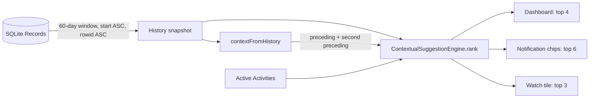

# Decayed Markov-2 Activity Suggestions

* **Author:** twang
* **Status:** Draft
* **Date:** 2026-11-05

--------------------------------------------------------------------------------

## Overview

Tempo labels the open Lap after the fact. When the user picks an Activity, the
app offers suggestions on three surfaces: the Today Dashboard, the Android
ongoing notification, and the Wear OS tile. The current engine ranks those
suggestions with flat counts: Markov-1 transitions, a ±1 hour temporal slot on
weekday versus weekend, and overall frequency.

This design replaces the flat counts with a 14-day half-life decay over a
60-day history window, adds Markov-2 transitions with backoff to Markov-1, and
keeps the existing temporal and frequency fallbacks. Every score is an integer
micro-weight, so equal scores compare exactly and the candidate-order
tie-breaker stays stable. The engine remains pure, deterministic, offline, and
free of new dependencies.

The design is already implemented. The draft records the behavior that shipped,
the review findings that shaped it, and the one measurement that is still open.

## The Problem

Three problems make the current suggestions worse than the history they are
built from.

1. **Age is ignored.** A Record from today and a Record from 29 days ago both
   count as `+1`. A routine the user stopped three weeks ago can still dominate
   a routine they started this week.
2. **One step of context is not enough.** Markov-1 only sees the immediately
   preceding Activity. It cannot tell `Gym → Shower → Dinner` from
   `Sleep → Shower → Commute`, because both share `Shower` as the immediate
   predecessor.
3. **The cutoff is a cliff.** The Dashboard drops history at 30 days, and the
   notification and watch paths share a 14-day window. A pattern does not fade at
   the edge; it disappears. The two different windows also make the same user
   see different rankings on different surfaces.

The review added three implementation hazards that the design had to close.
Midnight-split Records repeat the same Activity, so `Sleep → Sleep` is an
artifact, not a routine. The separate last-two-Record query can disagree with
the history chain after an edit or a concurrent commit. Treating an Untracked
Record as adjacency can invent a transition across an unlabeled night.

## Goals

- **Smooth decay.** Give each observation a weight of
  `0.5 ^ (ageDays / 14)` over a 60-day window. Today is about 1.0, 14 days ago
  is 0.5, and the window edge is about 0.05.
- **Routine context.** Add Markov-2 `(A_t-2, A_t-1) → A_t` and use it only when
  the pair is established. Otherwise back off to Markov-1 without changing the
  fallback order.
- **Decayed fallbacks.** Apply the same weight to the temporal slot and the
  overall frequency baseline.
- **Stable hierarchy.** Rank by Markov-2, then Markov-1, then temporal, then
  frequency, then the candidate's original index.
- **Honest adjacency.** Collapse consecutive equal Activity ids into one run, so
  MidnightSplits and repeated labels do not create self-transitions or
  double-count frequency.
- **One context source.** Derive both preceding ids from the same history
  snapshot the engine ranks.
- **Exact scores.** Hold weights as integer micro-units so equal scores do not
  drift by one floating-point bit.
- **Speed and determinism.** Stay under the 2 ms target for 6,000 Records,
  without a new dependency, network call, or model.
- **No integration regression.** Keep the Dashboard, notification chips, and
  Wear tile behavior intact while widening their history window.

## Non-Goals

- On-device or remote LLM inference, embeddings, or any API call.
- New dependencies, database schema changes, migrations, or cached aggregates.
- Markov-3 or longer n-grams.
- Weekday-conditioned transitions beyond the existing weekday/weekend temporal
  slot.
- Rotating-shift or travel-aware models.
- Dashboard, notification, or watch UI changes beyond the history window and
  the order that follows from the new scores.
- Changes to the desktop quick popover's separate recency list.
- A cache or precomputed index for the 60-day query.

## Open Questions

- **Question 1:** The 60-day `getRecords` query now runs on every Lap change on
  the notification and watch paths. The engine ranks 6,000 Records in about
  1.2 ms in the test runtime, but the end-to-end `publish()` and `_loadData()`
  cost has not been measured on device. If it regresses, does the fix belong in
  a query cache, a row cap, or a smaller watch window?
- **Question 2:** Deleted Activities are tombstoned but their Record rows
  remain. Those rows can contribute context mass to the trigram gate. Should
  tombstoned Activity ids be excluded from context mass, or is the phantom mass
  acceptable because it only affects whether a pair is considered established?
- **Question 3:** Once a pair is established, a rarely seen outcome inside that
  pair can outrank a strong Markov-1 sequence for the same pair. This is standard
  backoff behavior. Is a per-candidate minimum trigram weight worth adding, or
  should it wait for replay data?

## Critical User Journeys (CUJs)

### CUJ 1: Notification after a repeated routine

- **Given**: The last two closed runs are `Gym` then `Shower`, and the pair
  `(Gym, Shower)` has at least two completed observations in the 60-day window.
- **When**: The ongoing notification refreshes.
- **Then**: `Dinner` leads the six chips because it follows that pair, not
  because `Shower` is frequent in general. Tapping a chip labels the Lap and
  shows the Undo window.

### CUJ 2: Watch tile after a shared predecessor

- **Given**: The last two closed runs are `Sleep` then `Shower`.
- **When**: The Wear tile syncs.
- **Then**: `Commute` leads the three tile slots, while `Dinner` does not,
  because the pair is `(Sleep, Shower)` rather than `(Gym, Shower)`. Tapping a
  slot labels the Lap, gives haptic and visual confirmation, and finishes the
  Activity.

### CUJ 3: A new sequence replaces an old one

- **Given**: A user logged `Reading` every evening three weeks ago and has
  logged `Walk` every evening for the last three days.
- **When**: The Dashboard loads in the evening.
- **Then**: `Walk` outranks `Reading` without waiting for a 30-day cutoff. The
  older sequence is still present in the 60-day window, but its weight has decayed
  below the recent sequence's.

## Technical Plan (Architecture)

### 1. Ranking pipeline

`ContextualSuggestionEngine.rank` stays a pure, synchronous function. It takes
candidates, a history snapshot, the two preceding run ids, the target instant,
the target IANA zone, and a limit. It returns the top candidates in rank order.

The pipeline is:

1. Filter archived candidates and preserve their original index.
2. Resolve the target wall clock once: local hour and weekday/weekend.
3. Walk the history once, in order, building decayed scores.
4. Decide whether the Markov-2 tier is active.
5. Sort with the fixed hierarchy and return the first `limit`.

The walk does five things per run:

- **Weight**: resolve the run's decay weight from a whole-day table.
- **Frequency**: add the weight to the candidate's baseline.
- **Temporal**: add the weight when the run's local hour is within ±1 hour of
  the target and the weekday/weekend type matches.
- **Markov-1**: add the weight when the previous run equals the query's
  preceding Activity.
- **Markov-2**: add the weight to the pair's context mass when the previous two
  runs equal the query pair, and to the candidate's trigram score when the
  outcome is also a candidate.

The loop is order-dependent. Callers must pass history ordered by
`started_at_epoch_ms ASC, rowid ASC`.

### 2. Decay weights

The engine uses a 14-day half-life over a 60-day window. A whole-day bucket
keeps the arithmetic deterministic and removes `pow` from the per-record loop.

```text
ageDays   = (targetEpochMs - record.startedAtEpochMs) / 86_400_000
weight    = round(0.5 ^ (ageDays / 14) * 1_000_000)
window    = 0..60 days
```

The table is generated once. A Record that starts after the target, or whose
age is beyond 60 days, is treated as a gap and contributes nothing. Scores are
summed as integers. The maximum realistic sum is far below the 64-bit limit, so
no overflow handling is needed.

### 3. Runs, not Records

MidnightSplits write two Records with the same `activityId`. A repeated label
can do the same. Counting those as two steps would create `Sleep → Sleep`
transitions, inflate the pair gate, and double-count frequency.

The engine therefore collapses consecutive Records with the same non-null
Activity id into one run. A run's weight and temporal slot come from its first
Record. An Untracked Record resets the training chain: it does not become a
transition endpoint, and it does not bridge the Activity before it to the
Activity after it.

The query context uses a different rule. `contextFromHistory` skips Untracked
Records and collapses repeated labels to return the last two runs. That keeps
the context useful across an unlabeled gap while the training chain stays
honest.

### 4. Markov-2 gate and backoff

A pair is established when both conditions hold:

- At least two completed trigram observations of the query pair.
- At least 1,000,000 micro-weight of context mass for that pair, which is one
  fresh observation's worth of decayed evidence.

Context mass counts every outcome of the pair, including outcomes that are
archived or not offered as candidates. Candidate trigram scores count only
candidates. This split is intentional: the gate asks whether the pair is a real
routine, while the ranking asks which of the available Activities is most likely
next.

When the pair is established, the comparator starts with the candidate trigram
score. If two candidates both have zero trigram evidence, the comparison falls
through to Markov-1 rather than stopping at zero. When the pair is not
established, the trigram tier is skipped for every candidate.

Markov-1 only counts transitions whose predecessor is the query's preceding
run. It is not a general count of incoming transitions.

### 5. Comparator

The fixed order is:

1. Markov-2 score, descending, when the pair is established.
2. Markov-1 score, descending.
3. Temporal slot score, descending.
4. Decayed frequency score, descending.
5. Candidate original index, ascending.

All scores are integers, so an equal score reaches the next tier exactly. There
is no epsilon comparison.

### 6. Data flow



### 7. Public API

```text
class SuggestionContext:
    precedingActivityId: String?
    secondPrecedingActivityId: String?

class ContextualSuggestionEngine:
    historyWindowDays = 60
    historyWindow = 60 days

    contextFromHistory(history) -> SuggestionContext

    rank(
        candidates,
        history,
        precedingActivityId,
        secondPrecedingActivityId = null,
        targetEpochMs,
        timezoneId,
        limit = 6,
    ) -> List<Activity>
```

`secondPrecedingActivityId` is optional so existing callers and tests keep
working. When it is null, only Markov-1 is used. A second id without a first id
is a programming error; the engine asserts that in debug.

### 8. Caller changes

- **Dashboard**: query the engine's 60-day window instead of a hardcoded
  30 days, derive both ids from that snapshot, and keep the existing
  `_lastActivity` display query separate.
- **LapNotificationService**: query the same 60-day window, delete the separate
  last-closed query, and pass both ids from the history snapshot.
- **WearableSyncService**: do the same for the watch tile and delete the shared
  14-day `tileActivityWindow` constant.
- **All three**: add `rowid ASC` to the history order so equal start times are
  deterministic.

### 9. Boundary behavior

- Empty history: return candidates in their original order.
- One tracked run: no second id, so Markov-2 is skipped.
- Established pair with no candidate trigram: fall through to Markov-1.
- Untracked-only history: no context and no chain.
- Record starting after the target: excluded as a gap.
- Record older than 60 days: excluded as a gap.
- MidnightSplit or repeated label: one run, one observation.
- Equal scores: candidate list order decides.
- Archived candidate: filtered before scoring and before the index map.

## Alternatives Considered

### Alternative A: Per-candidate trigram gate

- **Pros**: The code is simpler. Any candidate with a trigram observation can
  enter the Markov-2 tier without a separate pair ledger.
- **Cons**: A single stray `(A, B) → D` event outranks a daily `B → C` habit.
  The user sees a one-off three-step accident replace a real routine.
- **Reason for Rejection**: This is the exact failure the pair gate exists to
  prevent. The gate costs one extra accumulator and removes the failure.

### Alternative B: Weighted blend instead of tiers

- **Pros**: One score per candidate instead of a conditional comparator. It
  degrades smoothly and avoids a hard tier boundary.
- **Cons**: Needs a tuning constant for the trigram-to-bigram ratio with no
  evidence behind it. It abandons the requested tier order and makes a
  suggestion harder to explain.
- **Reason for Rejection**: Deferred. It is the fallback if replay data shows
  the gate is too brittle, but the current design does not have the data to pick
  the ratio.

### Alternative C: Raw floating-point weights with an epsilon comparison

- **Pros**: Matches the formula directly and keeps the half-life continuous
  rather than bucketed by day.
- **Cons**: Equal sums can differ by an ulp depending on platform and
  accumulation order. An epsilon comparison then decides ties by a threshold
  that is itself arbitrary.
- **Reason for Rejection**: Integer micro-units make equal scores exact and keep
  the candidate-index tie-breaker stable.

### Alternative D: Per-record `pow` weights inside the loop

- **Pros**: The most literal implementation of the decay formula.
- **Cons**: Calls `pow` for every Record on every rank, and the rounded result
  can land on a platform-sensitive boundary.
- **Reason for Rejection**: A 61-entry whole-day table is generated once,
  removes the call from the hot loop, and preserves the promised values at 0 and
  14 days exactly.

### Alternative E: Keep the separate last-two-Record query

- **Pros**: No new context helper and no change to the existing query shape.
- **Cons**: Two sources of truth. A commit between the history query and the
  last-two query, an edit that moves a Boundary, or a MidnightSplit can make the
  supplied pair disagree with the chain tail. The trigram then fires on the
  wrong context or never fires, silently.
- **Reason for Rejection**: The history snapshot already contains the tail.
  Deriving both ids from it removes the race and a database round-trip.

### Alternative F: Bridge untracked gaps

- **Pros**: Preserves the last known Activity across an unlabeled stretch, which
  can be useful for the query context.
- **Cons**: `A, null, B → A → B` invents adjacency across a 20-hour hole or a
  night. Two unrelated days can satisfy the pair gate.
- **Reason for Rejection**: The domain treats an Untracked Record as unknown
  time, not as evidence of adjacency. The design skips nulls when finding the
  query context but breaks the training chain at a gap.

### Alternative G: Keep the 30-day Dashboard window and the 14-day tile window

- **Pros**: No query growth on the watch or notification path. The current
  tests and documentation stay unchanged.
- **Cons**: Both windows create the cliff the change exists to remove. Day 31
  and day 15 drop to zero, and the same user sees different rankings on
  different surfaces.
- **Reason for Rejection**: The decay needs a window long enough to fade
  smoothly. One 60-day engine window replaces the arbitrary split.

### Alternative H: On-device model or remote API

- **Pros**: Could model rotations, travel, and longer routines that a trigram
  cannot represent.
- **Cons**: Adds binary size, latency, battery use, non-determinism, or a
  network dependency. It conflicts with Tempo's offline, zero-cost, local-only
  constraints.
- **Reason for Rejection**: The routine problem does not need a model. Integer
  n-gram arithmetic solves the stated cases and stays deterministic.

### Alternative I: Markov-3 or longer n-grams

- **Pros**: More context for routines with four or more steps.
- **Cons**: Sparsity grows sharply. A four-step context rarely has enough
  observations to clear an evidence gate, and the extra state makes the ranking
  harder to explain.
- **Reason for Rejection**: Deferred. Markov-2 covers the two shared-predecessor
  cases in the goals; longer chains need replay data before they earn their
  complexity.

### Alternative J: Ship decay first and Markov-2 later

- **Pros**: Smaller changes and a shorter review cycle for each behavior.
- **Cons**: Both changes touch the same loop, the same tests, and the same three
  call sites. Splitting them doubles the churn and leaves an intermediate engine
  that is harder to reason about.
- **Reason for Rejection**: Kept together, with engine, callers, and
  verification staged as separate commits.

--------------------------------------------------------------------------------

## Non-Functional Requirements

- **Security & Privacy**: The engine reads Records already stored in the local
  SQLite database. It makes no network call, writes no telemetry, and adds no
  model or embedding. The existing PII handling is unchanged.
- **Performance & Latency**: The target is under 2 ms for 6,000 Records. The
  implemented engine measured about 1.2 ms for 6,000 Records with non-UTC zones
  in the test runtime. The CI regression guard is 5 ms. The 60-day database
  query is separate from that figure and is the remaining measurement gap.
- **Battery Impact**: Ranking is event-driven on Lap changes and notification
  refreshes. There is no polling loop. The 60-day query increases rows per
  event, so `publish()` and `_loadData()` need device measurement.
- **Determinism**: Integer micro-weights, a fixed history order, and an exact
  index tie-breaker make the same input produce the same order on every run.
- **Rollout & Rollback**: There is no schema change, migration, or feature flag.
  A normal app release ships the change, and reverting the commit rolls it back.
  No persisted data changes, so rollback is safe.

--------------------------------------------------------------------------------

### Additional Resources

- `CONTEXT.md` for the domain vocabulary: Record, Lap, Untracked Record,
  MidnightSplit, Boundary.
- `PRODUCT.md` for the product boundary and the no-judgment framing.
- `concepts_brief.md` for the Goldfish review and the resolved design decisions.
- `docs/designs/smart_activity_suggestion.md` for the original suggestion
  design, updated to describe the current engine.
- `test/core/suggestion_engine_test.dart` for the concrete ranking scenarios.

### Future Improvements

- **Measure the 60-day query**: profile `publish()` and `_loadData()` on device.
  If the row volume regresses the notification or watch path, add a cache, a
  row cap, or a dedicated query budget.
- **Replay harness**: score Markov-1, decay-only, and Markov-2 against a real
  user's own history for top-3 hit rate. The constants are currently justified
  by reasoning, not by a corpus.
- **Tombstoned Activities**: decide whether Record rows for deleted Activities
  should be excluded from context mass. Today they can help a pair clear the
  gate without being selectable.
- **Per-candidate trigram floor**: add one if replay shows a rare outcome inside
  an established pair displacing a strong Markov-1 sequence too often.
- **Weekday-conditioned transitions and shift/travel models**: the current
  temporal slot does not represent a rotating schedule or a trip.
- **Dashboard suggestion test**: the engine and the two notification surfaces
  have coverage; the Dashboard row does not have a widget test.
- **Weighted blend**: revisit if the tier gate proves too brittle in replay.

--------------------------------------------------------------------------------

## Detailed Implementation Plan

### Target Files to Create/Modify

#### 1. `lib/core/state/suggestion_engine.dart` (Modify)

- **Type / Scope**: Pure Dart domain logic.
- **Proposed Changes**:
  - Add the `SuggestionContext` value type with the two preceding run ids.
  - Add the engine-owned 60-day window, 14-day half-life, micro-unit scale, and
    the two trigram gate constants.
  - Add a whole-day weight table and a lookup that returns zero for a future or
    out-of-window Record.
  - Add `contextFromHistory`, which skips Untracked Records and collapses
    repeated labels to return the last two runs.
  - Extend `rank` with the optional `secondPrecedingActivityId`.
  - Replace the per-record count loop with a one-pass run walk that collapses
    equal consecutive Activity ids, resets at Untracked and out-of-window
    Records, and accumulates frequency, temporal, Markov-1, Markov-2, and
    context mass.
  - Apply the pair gate and the fixed comparator.
  - Document the ascending-history contract and the decay semantics.
- **Rationale**: This is the feature. Every surface consumes this one engine, so
  the scoring rules must live in one place.

#### 2. `lib/ui/dashboard_view.dart` (Modify)

- **Type / Scope**: Flutter view / data loading.
- **Proposed Changes**:
  - Replace the hardcoded 30-day cutoff with the engine's history window.
  - Order the history query by start time and `rowid`.
  - Derive both preceding ids with `contextFromHistory` and pass them to `rank`.
  - Keep the separate last-activity query for the existing display only.
- **Rationale**: The Dashboard must show the same decayed ranking as the other
  surfaces, without a second context query.

#### 3. `lib/notification/lap_notification_service.dart` (Modify)

- **Type / Scope**: Android ongoing notification.
- **Proposed Changes**:
  - Use the engine's 60-day window instead of the wearable 14-day constant.
  - Add `rowid` to the history order.
  - Delete the separate last-closed query and derive the context from the history
    snapshot.
  - Pass both preceding ids and drop the now-unused wearable import.
- **Rationale**: Removes the context race and one database round-trip while
  keeping the chip behavior and Undo flow unchanged.

#### 4. `lib/wearable/wearable_sync_service.dart` (Modify)

- **Type / Scope**: Wear OS Data Layer synchronization.
- **Proposed Changes**:
  - Delete the `tileActivityWindow` constant.
  - Use the engine's history window and `rowid` order.
  - Delete the separate last-closed query and derive the context from history.
  - Pass both preceding ids to `rank`.
- **Rationale**: The watch tile uses the same engine window and context rules as
  the phone. The window is engine policy, not a wearable detail.

#### 5. `test/core/suggestion_engine_test.dart` (Modify)

- **Type / Scope**: Unit tests.
- **Proposed Changes**:
  - Keep cold start, archived filtering, Markov-1, temporal, timezone, Midnight
    Split, and untracked-preceding coverage.
  - Add context-helper coverage for run collapsing and gap skipping.
  - Add Markov-2 disambiguation for `Gym → Shower → Dinner` versus
    `Sleep → Shower → Commute`.
  - Add unseen-pair backoff, stale-pair rejection, the half-life gate boundary,
    one-observation rejection, and the zero-candidate-trigram fallthrough.
  - Add decay ranking, temporal decay, future-Record exclusion, window-edge
    exclusion, tie-breaking, and a 6,000-Record performance guard.
- **Rationale**: The ranking is a chain of gates; each gate needs a test that
  fails if the condition is removed.

#### 6. `test/wearable/wearable_sync_service_test.dart` (Modify)

- **Type / Scope**: Call-site tests.
- **Proposed Changes**:
  - Rename the 14-day tile-window tests to describe the history window and
    decay.
  - Keep the exact tile-order assertions and the old-label case.
- **Rationale**: The test names must describe the behavior they now pin.

#### 7. `test/notification/lap_notification_service_test.dart` (Verify)

- **Type / Scope**: Call-site tests.
- **Proposed Changes**: No edit required. The existing chip-order, Markov
  transition, label, and Undo tests pass unchanged.
- **Rationale**: The notification surface is the main consumer of the new
  context path; running it unchanged is the regression check.

#### 8. `README.md` (Modify)

- **Type / Scope**: User-facing documentation.
- **Proposed Changes**: Replace the "last 14 days" tile description with the
  60-day, recent-weighted description.
- **Rationale**: The old claim is no longer true.

#### 9. `docs/designs/smart_activity_suggestion.md` (Modify)

- **Type / Scope**: Existing design document.
- **Proposed Changes**:
  - Add a revision note.
  - Update the goal, scoring tiers, architecture diagram, API, caching note,
    performance target, and test plan to describe the decayed Markov-2 engine.
- **Rationale**: The original document described Markov-1, a 30-day window, and
  a `SuggestionCache` that was never built.

#### 10. `concepts_brief.md` (Create)

- **Type / Scope**: Brainstorm artifact.
- **Proposed Changes**: Record the problem, the Goldfish review, the resolved
  revisions, the implementation status, and the remaining query risk.
- **Rationale**: `/egm-draft` consumes it as the predecessor context, and it
  keeps the review record for future sessions.

#### 11. `docs/designs/decayed_markov_2_activity_suggestions.md` (Create)

- **Type / Scope**: Design document.
- **Proposed Changes**: The finalized copy of `design_draft.md`, including this
  implementation plan.
- **Rationale**: The formal handoff from the brainstorm to review.

### Verification Plan

- **Static analysis**: `flutter analyze` across the repository. Expected: no
  issues.
- **Targeted unit and integration tests**:
  `flutter test test/core/suggestion_engine_test.dart test/wearable/wearable_sync_service_test.dart test/notification/lap_notification_service_test.dart`.
  Expected: all pass. Current count: 38 tests.
- **Performance**: 6,000 Records with non-UTC zones, measured in the test
  runtime. Expected: under 2 ms; the CI guard fails at 5 ms. Current result:
  about 1.2 ms.
- **Manual checks**:
  - Label a routine that shares an immediate predecessor with another routine
    and confirm the top suggestion differs by the pair.
  - Confirm a MidnightSplit night does not create a `Sleep → Sleep` suggestion.
  - Confirm the Dashboard, notification, and watch tile agree on the top
    Activity for the same history.
  - Confirm an old label is still present at 20 days but ranks below a recent
    label.
- **Remaining coverage gap**: add a Dashboard suggestion widget test. The
  current Dashboard changes are covered by analysis and by the shared engine,
  not by a surface-level test.
- **Remaining measurement gap**: profile the 60-day `getRecords` call end to end
  on device. The engine budget does not include the query.

--------------------------------------------------------------------------------

*Drafted with EGM*


