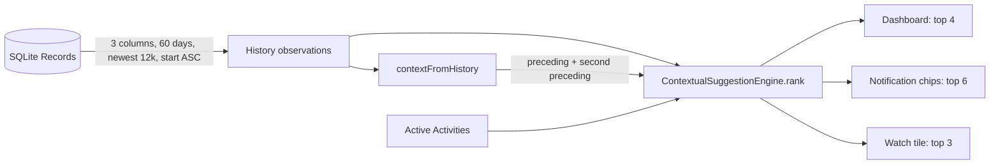

# Decayed Markov-2 Activity Suggestions

* **Author:** twang
* **Status:** In Review
* **Date:** 2026-11-05

--------------------------------------------------------------------------------

## Overview

Tempo labels the open Lap after the fact. When the user picks an Activity, the
app offers suggestions on three surfaces: the Today Dashboard, the Android
ongoing notification, and the Wear OS tile. The previous engine ranked those
suggestions with flat counts: Markov-1 transitions, a ±1 hour temporal slot on
weekday versus weekend, and overall frequency.

This design replaces the flat counts with a 14-day half-life decay over a
60-day history window, adds Markov-2 transitions with backoff to Markov-1, and
keeps the temporal and frequency fallbacks. Every score is an integer
micro-weight, so equal scores compare exactly and the candidate-order
tie-breaker stays stable. The engine remains pure, deterministic, offline, and
free of new dependencies.

The design was reviewed in an EGM Goldfish review. The review record is
`concepts_brief.md`; the consolidated findings are in
`consolidated_review_report.md`. This document records the design after that
review and the changes that shipped.

## Problem Statement

Three properties made the previous suggestions diverge from the history they
read.

1. **Age was ignored.** A Record from today and a Record from 29 days ago both
   counted as `+1`, so older evidence could outrank newer evidence.
2. **One step of context was not enough.** Markov-1 only saw the immediately
   preceding Activity. It could not tell `Gym → Shower → Dinner` from
   `Sleep → Shower → Commute`, because both share `Shower` as the immediate
   predecessor.
3. **The cutoff was a discontinuity.** The Dashboard dropped history at 30 days,
   and the notification and watch paths shared a 14-day window. Evidence did not
   fade at the edge; it disappeared. The two windows also made the same user see
   different rankings on different surfaces.

The review identified three implementation hazards. MidnightSplit Records repeat
the same Activity, so `Sleep → Sleep` is an artifact, not a sequence. A separate
last-two-Record query can disagree with the ranked chain. Treating an Untracked
Record as adjacency can invent a transition across an unlabeled night.

## Goals

- **Daily-stepped decay.** Give each observation a weight of
  `0.5 ^ (ageDays / 14)` over a 60-day window. Today is about 1.0, 14 days ago is
  0.5, and the window edge is about 0.05. The engine uses whole-day buckets, so
  the decay is stepped by day rather than continuous.
- **Routine context.** Add Markov-2 `(A_t-2, A_t-1) → A_t` and use it only when
  the pair is established and the candidate carries a meaningful share of the
  pair's evidence. Otherwise back off to Markov-1 without changing the fallback
  order.
- **Decayed fallbacks.** Apply the same weight to the temporal slot and the
  overall frequency baseline.
- **Stable hierarchy.** Rank by Markov-2, then Markov-1, then temporal, then
  frequency, then the candidate's original index.
- **Honest adjacency.** Collapse consecutive equal Activity ids into one run, so
  MidnightSplits and repeated labels do not create self-transitions or
  double-count frequency. Break the chain at Untracked and out-of-window
  Records.
- **One context source.** Derive both preceding runs from the same history
  snapshot the engine ranks, using the same chain rule.
- **Lean history read.** Read only the three fields the engine needs, skip tag
  hydration, bound the row count, and exclude future-dated Records at the query.
- **Exact scores.** Hold weights as integer micro-units so equal scores do not
  drift by one floating-point bit.
- **Speed and determinism.** Stay under the 2 ms target for 6,000 observations,
  without a new dependency, network call, or model.
- **No integration regression.** Keep the Dashboard, notification chips, and
  Wear tile behavior intact while widening their history window.

## Non-Goals

- On-device or remote LLM inference, embeddings, or any API call.
- New dependencies, database schema changes, or migrations.
- A cache, precomputed index, or second history store. The allowed remedy for
  query cost is a lean read and a row bound.
- Markov-3 or longer n-grams.
- Weekday-conditioned transitions beyond the existing weekday/weekend temporal
  slot.
- Rotating-shift or travel-aware models.
- Dashboard, notification, or watch UI changes beyond the history window and
  the order that follows from the new scores.
- Changes to the desktop QuickPopover's separate recency list.

## Critical User Journeys (CUJs)

### CUJ 1: Notification after a repeated sequence

- **Given**: The last two closed runs are `Gym` then `Shower`, and the pair
  `(Gym, Shower)` has at least two completed observations in the 60-day window.
- **When**: The ongoing notification refreshes.
- **Then**: `Dinner` leads the six chips because it carries enough of that
  pair's evidence, not because `Shower` is frequent in general. Tapping a chip
  labels the Lap and shows the Undo window. Remaining slots are filled with the
  other active Activities in their list order.

### CUJ 2: Watch tile after a shared predecessor

- **Given**: The last two closed runs are `Sleep` then `Shower`.
- **When**: The Wear tile syncs.
- **Then**: `Commute` leads the three tile slots, while `Dinner` does not,
  because the pair is `(Sleep, Shower)` rather than `(Gym, Shower)`. Tapping a
  slot labels the Lap, gives haptic and visual confirmation, and finishes the
  Activity.

### CUJ 3: A new sequence replaces an old one

- **Given**: A user logged `Reading` every evening three weeks ago and has
  logged `Walk` every evening for the last three days.
- **When**: The Dashboard loads in the evening.
- **Then**: `Walk` outranks `Reading` without waiting for a 30-day cutoff. The
  older sequence is still present in the 60-day window, but its weight has
  decayed below the recent sequence's.

### CUJ 4: Cold start

- **Given**: There are no Records in the 60-day window.
- **When**: Any surface loads.
- **Then**: The suggestion list is empty. The Dashboard hides the suggestion
  strip; the notification and watch fill their slots with the user's active
  Activities in list order. No surface ranks an empty history.

## Technical Plan (Architecture)

### 1. Ranking pipeline

`ContextualSuggestionEngine.rank` is a pure, synchronous function. It takes
candidates, a history of `SuggestionObservation`s, the two preceding run ids,
the target instant, the target IANA zone, and a limit. It returns the top
candidates in rank order.

The pipeline is:

1. Filter archived candidates and preserve their original index.
2. Resolve the target wall clock once: local hour and weekday/weekend.
3. Walk the history once, in order, building decayed scores.
4. Decide whether the Markov-2 tier is active.
5. Sort with the fixed hierarchy and return the first `limit`.

The walk does five things per run:

- **Weight**: resolve the run's decay weight from a whole-day table.
- **Frequency**: add the weight to the candidate's baseline.
- **Temporal**: add the weight when the run's local hour is within ±1 hour of
  the target and the weekday/weekend type matches. The hour is resolved in the
  Record's own `timezoneId`; the target hour is resolved in the query zone. The
  match includes the 23:00 to 00:00 wrap (`diff == 23`).
- **Markov-1**: add the weight when the previous run equals the query's
  preceding Activity.
- **Markov-2**: add the weight to the pair's context mass when the previous two
  runs equal the query pair, and to the candidate's trigram score when the
  outcome is also a candidate.

The loop is order-dependent. Callers pass history ordered by
`started_at_epoch_ms ASC, rowid ASC`.

### 2. Decay weights

The engine uses a 14-day half-life over a 60-day window. A whole-day bucket
keeps the arithmetic deterministic and removes `pow` from the per-record loop.

```text
ageMs    = targetEpochMs - observation.startedAtEpochMs
exclude  when ageMs < 0 or ageMs > 60 days
ageDays  = ageMs ~/ 86_400_000        // integer division, 0..60
weight   = round(0.5 ^ (ageDays / 14) * 1_000_000)
```

A Record at exactly 60 days uses bucket 60; a Record at 60 days plus one
millisecond is excluded. The callers' `startedAfter` uses the same boundary.
The table is generated once. Scores are summed as integers; the largest single
accumulator is `61 × 1,000,000 = 61,000,000`, far below the 64-bit limit.

### 3. Runs, not Records

MidnightSplits write two Records with the same `activityId`. A repeated label
can do the same. Counting those as two steps would create `Sleep → Sleep`
transitions, inflate the pair gate, and double-count frequency.

The engine collapses consecutive observations with the same non-null Activity
id into one run. A run's weight and temporal slot come from its first
observation. An Untracked, future-started, or out-of-window Record clears all
three chain fields: `previousRunId`, `secondPreviousRunId`, and `currentRunId`.
The Record is not merely skipped, because skipping would bridge the gap.

The query context follows the same rule. `contextFromHistory(history,
targetEpochMs)` walks forward, clears both ids at Untracked, future-started, and
out-of-window Records, and collapses repeated labels. It returns the last two
runs that the chain would also accept. Callers pass `now`.

### 4. Markov-2 gate and backoff

Markov-2 observations are trigrams: a pair `(A, B)` plus the outcome `C`.
Markov-1 observations are bigrams: `B` plus the outcome `C`.

A pair is established when both conditions hold:

- At least two completed trigram observations of the query pair.
- At least 1,000,000 micro-weight of context mass for that pair, which is one
  fresh observation's worth of decayed evidence.

Context mass counts every outcome of the pair, including outcomes that are
archived or not offered as candidates. Candidate trigram scores count only
candidates. This split is intentional: the gate asks whether the pair is a
pattern, while the ranking asks which of the available Activities is most likely
next.

When the pair is established, a candidate enters the Markov-2 tier only when its
trigram score is at least one tenth of the pair's context mass. A candidate below
that share falls through to Markov-1. This stops a single old outcome from
outranking a strong Markov-1 sequence. When the pair is not established, the
trigram tier is skipped for every candidate.

Markov-1 only counts transitions whose predecessor is the query's preceding
run. It is not a general count of incoming transitions.

### 5. Parameter choices

| Constant | Value | Rejected values | Reason |
| --- | --- | --- | --- |
| Half-life | 14 days | 7, 30 | 7 reacts too hard to one day; 30 keeps a stopped pattern too long. |
| Window | 60 days | 30, 90 | 30 creates the discontinuity; 90 adds rows with almost no weight. |
| Pair minimum observations | 2 | 1 | One fresh observation is the stray-event failure the gate exists to stop. |
| Pair minimum mass | 1,000,000 micros | 500,000 | Half a fresh observation admits stale repeats. |
| Candidate trigram share | 10% of context mass | 0% | Any token outcome would outrank a strong Markov-1 sequence. |

The combined gate envelope: a pair is accepted when it has been seen at least
twice and still carries one fresh observation's worth of decayed evidence. Two
observations at the 14-day half-life meet the mass floor; two at 21 days score
about 0.71 and fail. The constants rest on reasoning, not a replay corpus; the
replay harness in Future Improvements is the way to calibrate them.

### 6. Comparator

The fixed order is:

1. Markov-2 score, descending, when the pair is established and the candidate
   clears the 10% share.
2. Markov-1 score, descending.
3. Temporal slot score, descending.
4. Decayed frequency score, descending.
5. Candidate original index, ascending.

All scores are integers, so an equal score reaches the next tier exactly. There
is no epsilon comparison.

### 7. Data flow



The read is `TempoDatabase.getSuggestionHistory`: it selects only
`activity_id`, `started_at_epoch_ms`, and `timezone_id`, skips tag hydration,
orders newest-first so the 12,000-row cap keeps recent evidence, then reverses
to ascending for the engine. `startedBefore: now` excludes future-dated rows.

### 8. Public API

```text
class SuggestionObservation:
    activityId: String?
    startedAtEpochMs: int
    timezoneId: String

class SuggestionContext:
    precedingActivityId: String?
    secondPrecedingActivityId: String?

class ContextualSuggestionEngine:
    static historyWindowDays = 60
    static historyWindow = Duration(days: historyWindowDays)

    static contextFromHistory(
        Iterable<SuggestionObservation> history,
        {required int targetEpochMs},
    ) -> SuggestionContext

    rank(
        {required List<Activity> candidates,
         required Iterable<SuggestionObservation> history,
         required String? precedingActivityId,
         String? secondPrecedingActivityId,
         required int targetEpochMs,
         required String timezoneId,
         int limit = 6},
    ) -> List<Activity>
```

`secondPrecedingActivityId` is optional so callers and tests can supply an
explicit context. The production path derives both ids from the same history
snapshot through `contextFromHistory`. A second id without a first id is a
programming error; the engine asserts that in debug.

### 9. Caller changes

- **Shared loader**: `lib/core/state/suggestion_loader.dart` exposes
  `loadSuggestions({database, candidates, nowEpochMs, timezoneId, limit})`. It
  owns the window, lean read, cap, context derivation, ranking, and limit. It
  stays a function, not a service or cache.
- **Dashboard**: calls the loader with limit 4. It keeps a separate last-activity
  query for the existing display only.
- **LapNotificationService**: calls the loader with limit 6 and fills remaining
  chips with the other active Activities in list order.
- **WearableSyncService**: calls the loader with limit 3 and fills remaining
  tile slots the same way.
- The separate last-closed query and the shared 14-day `tileActivityWindow` are
  removed. `lib/core/state/activity_ranking.dart` is deleted because it has no
  references and is superseded by the engine.

### 10. Boundary behavior

- Empty history: the engine returns candidates in their original order; the
  Dashboard shows no suggestion strip and the other surfaces fill from the
  Activity list.
- One tracked run: no second id, so Markov-2 is skipped.
- Established pair with no candidate above the 10% share: fall through to
  Markov-1.
- Untracked-only history: no context and no chain.
- Record starting after the target: excluded and the chain resets.
- Record older than 60 days: excluded and the chain resets.
- Exactly 60 days old: included in bucket 60.
- MidnightSplit or repeated label: one run, one observation.
- Equal scores: candidate list order decides.
- Archived candidate: filtered before scoring and before the index map.
- `limit <= 0` or every candidate archived: return an empty list.

## Open Questions

- **Question 1:** The engine ranks 6,000 observations in about 1.6 ms in the test
  runtime, but the end-to-end cost of `getSuggestionHistory` plus `rank` on the
  notification and watch paths has not been measured on a mid-range device. The
  lean read and the 12,000-row cap are in place. Measure `publish()` and
  `_loadData()` p95 and record the result. The triggers are label, Split, Undo,
  Edge edit, MidnightSplit, watch label, and deep-link label.

## Resolved Questions

- **Tombstoned Activities:** accepted. Context mass counts outcomes for
  tombstoned and archived Activities; this only affects whether a pair is
  established, not which candidates can be chosen. A future cleanup may make a
  tombstoned id break the chain.
- **Rare outcome inside an established pair:** resolved with the 10% candidate
  share in §4. A token outcome falls through to Markov-1.

## Alternatives Considered

### Alternative A: Per-candidate trigram gate

- **Pros**: The code is simpler. Any candidate with a trigram observation can
  enter the Markov-2 tier without a separate pair ledger.
- **Cons**: A single stray `(A, B) → D` event outranks a daily `B → C` sequence.
- **Reason for Rejection**: The pair gate plus the 10% candidate share removes
  that failure.

### Alternative B: Weighted blend instead of tiers

- **Pros**: One score per candidate and a smooth degradation.
- **Cons**: Needs a tuning constant for the trigram-to-bigram ratio with no
  evidence behind it, and abandons the requested tier order.
- **Reason for Rejection**: Deferred until the replay harness can pick the
  ratio.

### Alternative C: Raw floating-point weights with an epsilon comparison

- **Pros**: Matches the formula continuously.
- **Cons**: Equal sums can differ by an ulp by platform and accumulation order.
- **Reason for Rejection**: Integer micro-units make equal scores exact.

### Alternative D: Per-record `pow` weights inside the loop

- **Pros**: The most literal implementation of the decay formula.
- **Cons**: Calls `pow` for every observation and can land on a platform-sensitive
  rounding boundary.
- **Reason for Rejection**: A whole-day table is generated once and keeps the
  promised values at 0 and 14 days exact.

### Alternative E: Keep the separate last-two-Record query

- **Pros**: No new context helper and no change to the query shape.
- **Cons**: Two sources of truth; a commit between the queries can make the pair
  disagree with the chain.
- **Reason for Rejection**: The history snapshot already contains the tail.
  Deriving both ids from it removes the race.

### Alternative F: Bridge untracked gaps

- **Pros**: Preserves the last known Activity across an unlabeled stretch.
- **Cons**: `A, untracked, B → A → B` invents adjacency across a 20-hour hole.
- **Reason for Rejection**: The domain treats an Untracked Record as unknown
  time. The context and the chain both break at the gap.

### Alternative G: Keep the 30-day Dashboard window and the 14-day tile window

- **Pros**: No query growth on the watch or notification path.
- **Cons**: Both windows create the discontinuity the change exists to remove,
  and the same user sees different rankings on different surfaces.
- **Reason for Rejection**: One 60-day engine window replaces the split, and the
  lean read plus the 12,000-row cap bounds the cost.

### Alternative H: On-device model or remote API

- **Pros**: Could model rotations, travel, and longer sequences.
- **Cons**: Adds binary size, latency, battery use, non-determinism, or a network
  dependency.
- **Reason for Rejection**: The routine problem does not need a model.

### Alternative I: Markov-3 or longer n-grams

- **Pros**: More context for sequences with four or more steps.
- **Cons**: Sparsity grows sharply, and the extra state is hard to explain.
- **Reason for Rejection**: Deferred until replay data shows Markov-2 is not
  enough.

### Alternative J: Ship decay first and Markov-2 later

- **Pros**: Smaller changes and shorter review cycles.
- **Cons**: Both changes touch the same loop, tests, and call sites.
- **Reason for Rejection**: Kept together, with engine, callers, and verification
  staged as separate phases.

### Alternative K: Cache or precomputed index

- **Pros**: Avoids re-reading the 60-day window on every Lap change.
- **Cons**: Adds invalidation, a second source of truth, and runtime state for a
  bounded read that now selects three columns and skips tags.
- **Reason for Rejection**: The lean read and row cap are the allowed remedy;
  caching is a non-goal.

--------------------------------------------------------------------------------

## Non-Functional Requirements

- **Security & Privacy**: The engine reads Records already stored in the local
  SQLite database. It makes no network call, writes no telemetry, and adds no
  model or embedding. PII handling is unchanged.
- **Performance & Latency**: The engine target is under 2 ms for 6,000
  observations. The current test measurement is about 1.6 ms with non-UTC zones;
  the CI regression guard is 5 ms. The history read projects three columns,
  skips tag hydration, and caps at 12,000 rows. The end-to-end query cost is the
  remaining measurement gap.
- **Battery Impact**: Ranking is event-driven on Lap changes and notification
  refreshes. There is no polling loop. The 60-day read is bounded, but its
  per-event cost still needs device measurement.
- **Determinism**: Integer micro-weights, a fixed history order, and an exact
  index tie-breaker make the same input produce the same order on every run.
- **Rollout & Rollback**: There is no schema change, migration, or feature flag.
  A normal app release ships the change. Rollback means the next release, not a
  retroactive store rollback. No persisted data changes.

--------------------------------------------------------------------------------

## Risks & Mitigations

| Risk | Mitigation |
| --- | --- |
| 60-day read slows the notification or watch path | Three-column projection, no tag hydration, 12,000-row cap, newest-first read; measure p95 on device and lower the cap if needed. |
| A stale or interrupted pattern keeps winning | 14-day half-life and a 60-day window; the pair must still carry one fresh observation's worth of mass. |
| Tombstoned Activities inflate context mass | Accepted: mass only decides whether a pair is established, not which candidates can be chosen. Revisit if replay shows harm. |
| A rare outcome inside an established pair displaces a strong Markov-1 sequence | 10% candidate share; a token outcome falls through to Markov-1. |
| Clock skew or future-dated Records | `startedBefore: now` at the query and an explicit future/out-of-window reset in the chain and context. |
| MidnightSplits fabricate `Sleep → Sleep` | Consecutive equal Activity ids collapse into one run before counting. |
| The three surfaces drift again | One shared loader owns the window, read, context, rank, and limit. |
| The constants are calibrated on reasoning only | Offline replay harness in Future Improvements; no runtime telemetry. |

--------------------------------------------------------------------------------

## Additional Resources

- `CONTEXT.md` for the domain vocabulary: Record, Lap, Untracked Record,
  MidnightSplit, Boundary.
- `PRODUCT.md` for the product boundary and the no-judgment framing.
- `concepts_brief.md` for the Goldfish review and the resolved design decisions.
- `consolidated_review_report.md` for the consolidated findings and the
  traceability matrix.
- `docs/designs/smart_activity_suggestion.md` for the original suggestion design.
- `test/core/suggestion_engine_test.dart` and
  `test/core/suggestion_loader_test.dart` for the concrete ranking and loader
  scenarios.

## Future Improvements

- **Measure the 60-day read**: profile `publish()` and `_loadData()` on device.
  If the cap is reached, lower it or add a column projection beyond the current
  three fields.
- **Replay harness**: score Markov-1, decay-only, and Markov-2 against a real
  user's own history for top-3 hit rate. The constants are justified by
  reasoning, not a corpus.
- **Tombstoned Activities**: decide whether a tombstoned id should break the
  chain like an Untracked Record.
- **Weekday-conditioned transitions and shift/travel models**: the current
  temporal slot does not represent a rotating schedule or a trip.
- **Column projection**: the loader already selects three columns; if the SQLite
  read is still expensive, add a dedicated observation table or index.
- **Weighted blend**: revisit if the tier gate proves too brittle in replay.

--------------------------------------------------------------------------------

## Detailed Implementation Plan

### Status

| Area | Status |
| --- | --- |
| Decayed engine, run collapsing, context helper, candidate share | Shipped |
| Shared loader, lean three-column read, 12,000-row cap, `startedBefore` | Shipped |
| Dashboard, notification, and wearable callers | Shipped |
| Engine, loader, call-site, and Dashboard tests | Shipped |
| README and original design document | Updated |
| On-device `publish()` and `_loadData()` measurement | Remaining |

### Phases

1. **Engine**: decay table, run collapsing, Markov-1, Markov-2, context helper,
   candidate share, and engine tests. Checkpoint:
   `flutter test test/core/suggestion_engine_test.dart`.
2. **Read seam and callers**: `SuggestionObservation`,
   `getSuggestionHistory`, `loadSuggestions`, and the three callers. Checkpoint:
   `flutter test test/core/suggestion_loader_test.dart
   test/notification/lap_notification_service_test.dart
   test/wearable/wearable_sync_service_test.dart`.
3. **Documentation and verification**: README, the original design document,
   this document, `flutter analyze`, and the full targeted suite. Each phase
   leaves the repository analyzable and testable.

### Target Files to Create/Modify

#### 1. `lib/core/state/suggestion_engine.dart` (Modify)

- **Type / Scope**: Pure Dart domain logic.
- **Proposed Changes**:
  - Add the `SuggestionContext` value type.
  - Add the engine-owned 60-day window, 14-day half-life, micro-unit scale,
    pair gate constants, and the candidate share.
  - Add the whole-day weight table and the exact 60-day boundary.
  - Add `contextFromHistory(history, targetEpochMs)`, which breaks at Untracked,
    future, and out-of-window Records and collapses repeats.
  - Rank over `SuggestionObservation`, collapse runs, accumulate frequency,
    temporal, Markov-1, Markov-2, and context mass.
  - Apply the pair gate and the candidate share in the comparator.
  - Document the ascending-history contract.
- **Rationale**: This is the scoring engine every surface consumes.

#### 2. `lib/data/models/suggestion_observation.dart` (Create)

- **Type / Scope**: Data model.
- **Proposed Changes**: Add the three-field observation type used by the lean
  history read.
- **Rationale**: The engine does not need full Records or tags.

#### 3. `lib/data/models/models.dart` (Modify)

- **Type / Scope**: Barrel export.
- **Proposed Changes**: Export `suggestion_observation.dart`.
- **Rationale**: Keep the model available through the existing import.

#### 4. `lib/data/database/tempo_database.dart` (Modify)

- **Type / Scope**: SQLite wrapper.
- **Proposed Changes**: Add `getSuggestionHistory({startedAfter,
  startedBefore, limit})` selecting only `activity_id`,
  `started_at_epoch_ms`, and `timezone_id`; order newest-first; reverse to
  ascending.
- **Rationale**: Projection, no tags, a bound, and future exclusion in one read.

#### 5. `lib/core/state/suggestion_loader.dart` (Create)

- **Type / Scope**: Shared read-and-rank function.
- **Proposed Changes**: Add `loadSuggestions` and the 12,000-row cap. Own the
  window, lean read, context, rank, and limit. Stay a function, not a service.
- **Rationale**: Remove the triplicated query/context/rank block and the drift
  that produced the 30/14-day split.

#### 6. `lib/ui/dashboard_view.dart` (Modify)

- **Type / Scope**: Flutter view / data loading.
- **Proposed Changes**: Call `loadSuggestions` with limit 4. Keep the
  last-activity display query.
- **Rationale**: The Dashboard uses the same shared path as the other surfaces.

#### 7. `lib/notification/lap_notification_service.dart` (Modify)

- **Type / Scope**: Android ongoing notification.
- **Proposed Changes**: Call `loadSuggestions` with limit 6; keep the
  fill-remaining chip behavior.
- **Rationale**: Remove the duplicated query/context block and the context race.

#### 8. `lib/wearable/wearable_sync_service.dart` (Modify)

- **Type / Scope**: Wear OS Data Layer synchronization.
- **Proposed Changes**: Call `loadSuggestions` with limit 3; keep the
  fill-remaining tile behavior.
- **Rationale**: The watch uses the same window and context rules as the phone.

#### 9. `lib/core/state/activity_ranking.dart` (Delete)

- **Type / Scope**: Superseded helper.
- **Proposed Changes**: Delete the file.
- **Rationale**: `rankActivitiesByUse` has no references in `lib/` or `test/`
  and the engine replaces its fallback fill.

#### 10. `test/core/suggestion_engine_test.dart` (Modify)

- **Type / Scope**: Unit tests.
- **Proposed Changes**: Cover cold start, archived filtering, Markov-1,
  temporal and hour-wrap, timezone, MidnightSplit collapsing, context gap
  resets, Markov-2 disambiguation, unseen-pair backoff, stale-pair rejection,
  the half-life gate, the candidate share, untracked gaps, future and window
  edges, tie-breaking, and the 6,000-observation performance guard.
- **Rationale**: Each gate and tie-breaker needs a test that fails when removed.

#### 11. `test/core/suggestion_loader_test.dart` (Create)

- **Type / Scope**: Loader tests.
- **Proposed Changes**: Cover the routine context from the lean history, the
  60-day window exclusion, and future-dated exclusion.
- **Rationale**: The shared loader is the single production path; one test
  covers the three callers' common behavior.

#### 12. `test/notification/lap_notification_service_test.dart` (Verify)

- **Type / Scope**: Call-site tests.
- **Proposed Changes**: No edit required; the existing chip, Markov, label, and
  Undo tests pass through the loader.
- **Rationale**: Confirms the notification surface.

#### 13. `test/wearable/wearable_sync_service_test.dart` (Modify)

- **Type / Scope**: Call-site tests.
- **Proposed Changes**: Keep the history-window and decay names and the exact
  tile-order assertions.
- **Rationale**: The window and ranking changed; the test names must describe
  what they pin.

#### 14. `test/ui/color_blocks_dashboard_test.dart` (Verify)

- **Type / Scope**: Dashboard widget test.
- **Proposed Changes**: No edit required. The existing
  `suggested activities row renders when suggestions exist and labels on tap`
  test seeds history and exercises the suggested chip.
- **Rationale**: The Dashboard surface already has coverage; the design no
  longer claims a gap.

#### 15. `README.md` (Modify)

- **Type / Scope**: User-facing documentation.
- **Proposed Changes**: Describe the 60-day, recent-weighted tile.
- **Rationale**: The old "last 14 days" claim is no longer true.

#### 16. `docs/designs/smart_activity_suggestion.md` (Modify)

- **Type / Scope**: Original design document.
- **Proposed Changes**: Keep the revision note and the updated scoring, API,
  diagram, performance, and test plan.
- **Rationale**: The original document described Markov-1, a 30-day window, and
  a cache that was never built.

#### 17. `concepts_brief.md` (Create/Exists)

- **Type / Scope**: Brainstorm and review artifact.
- **Proposed Changes**: Record the problem, the Goldfish review, the resolved
  revisions, the implementation status, and the remaining measurement.
- **Rationale**: The design's predecessor context and review record.

### Verification Plan

- **Static analysis**: `flutter analyze`. Expected: no issues.
- **Targeted tests**: `flutter test test/core/suggestion_engine_test.dart
  test/core/suggestion_loader_test.dart
  test/notification/lap_notification_service_test.dart
  test/wearable/wearable_sync_service_test.dart
  test/ui/color_blocks_dashboard_test.dart`. Expected: all pass. Current count:
  45 tests.
- **Performance**: 6,000 observations with non-UTC zones. Expected under 2 ms;
  the CI guard fails at 5 ms. Current measurement: about 1.6 ms.
- **Manual fixture**:
  - Seed two `Gym 18:00 → Shower 18:30 → Dinner 19:00` days and two
    `Sleep 07:00 → Shower 07:30 → Commute 08:00` days.
  - At 18:00 with context `(Gym, Shower)`, the top suggestion is `Dinner`.
  - At 08:00 with context `(Sleep, Shower)`, the top suggestion is `Commute`.
  - The surfaces request 4, 6, and 3 candidates; compare the top-1 only.
  - Confirm a MidnightSplit night does not create a `Sleep → Sleep` suggestion.
  - Confirm a 20-day-old label is present but below a recent label.
- **Remaining measurement**: profile `publish()` and `_loadData()` p95 on a
  mid-range device and record the number. This is the only open item.

--------------------------------------------------------------------------------

*Drafted with EGM*
