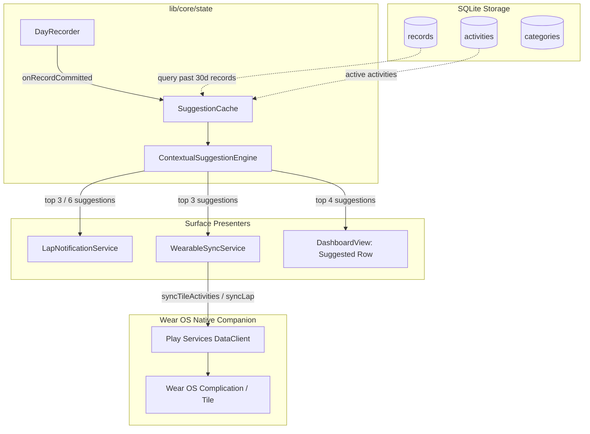

# Smart Activity Suggestion Engine & Visual Coherence

*   **Author:** Tony Wang
*   **Status:** In Review
*   **Date:** 2026-11-04

--------------------------------------------------------------------------------

## Overview

Tempo captures time retrospectively without judgment, goals, or streaks. When labeling the open interval to close it into a Record, the user selects from their configured Activities. Currently, activities in notifications and Wear OS are ranked solely by raw historical frequency (`rankActivitiesByUse`), and in the main app by static orderings (category, manual, alphabetical, pinned).

This feature introduces a contextual prediction engine that predicts the most likely Activity to be logged next, reordering:
1. **Android ongoing notification chips**: Top 3 collapsed, top 6 expanded.
2. **Wear OS ongoing notification & tiles**: Top 3 dynamic suggestions, maintaining strict action-and-exit compliance.
3. **Today Dashboard**: A dedicated, constant-height **"Suggested"** top row that avoids vertical layout jumping and preserves category grid muscle memory.

Additionally, this proposal addresses visual coherence and import fidelity:
- Activities inherit the exact color of their assigned Category unless explicitly overridden.
- Category & Activity icons and direct Unicode emojis are supported with clean fallbacks and database backfills.
- Simple Time Tracker (STT) import now upserts tags (especially `"Contact"`) into the `tags` table and attaches them to imported records via `record_tags` without requiring complex tag management UI.

All core processing remains strictly local, deterministic, and privacy-preserving.

## The Problem

1. **Repetitive Scrolling & Inefficient Labeling**: Users have clear temporal and sequential routines (e.g., Breakfast following Sleep in the morning; Commute following Work in the evening). A static list or simple global frequency ranking forces unnecessary horizontal scrolling or grid browsing.
2. **Muscle Memory Disruption Risk**: Dynamically rearranging the entire 3-column Today grid would disorient users whose physical finger-tap memory expects activities to remain in predictable positions.
3. **Visual Inconsistency**: Activities within the same Category often display inconsistent default colors or lack intuitive icon/emoji representations, cluttering the quick-label surfaces.
4. **Privacy & Battery Hazards of Passive Tracking**: Many trackers rely on invasive system app-tracking permissions that drain battery and violate user privacy. Tempo requires an architecture that delivers high predictive accuracy locally without mandatory background permissions.

## Goals

*   **Sub-5ms Local Contextual Suggestions**: Implement a lightweight Markov-1 and temporal slotting algorithm in `lib/core/state/suggestion_engine.dart` that ranks activities using preceding activity transitions, time-of-day buckets, and weekday/weekend patterns.
*   **Time Arithmetic Invariance Compliance**: Adhere strictly to Tempo's core invariant: all calculations anchor to UTC epoch milliseconds and explicit IANA `timezone_id` resolution.
*   **Zero-Disruption Today UX**: Surface the top 3–4 suggestions in a dedicated, fixed-height horizontal chip row above the Today grid, preserving 100% of the category grid's layout stability.
*   **Seamless Notification & Wear OS Integration**: Populate Android notification chips (top 3 / top 6) and Wear OS tiles (top 3) with dynamic suggestions, upholding Wear OS immediate `Activity.finish()` compliance.
*   **Visual Uniformity & Emoji Support**: Ensure activities inherit parent Category color hexes and support Unicode emojis, backed by an automated SQLite migration backfill.
*   **Simple Time Tracker Tag Import Fidelity**: Upsert tags encountered in STT imports (especially `"Contact"`) into the SQLite `tags` table and link them to imported records via `record_tags` without adding full tag management complexity.

## Non-Goals

*   **No Autonomous / Background Logging**: The engine never closes, splits, or labels an interval without an explicit physical tap from the user.
*   **No Productivity / Focus / Habit Framing**: The UI and copy will not display evaluative nudges, streaks, badges, or judgmental copy ("Time to get back to work!").
*   **No Cloud Sync or External ML Models**: No data is transmitted off-device; no heavy neural network weights or LLM embedding dependencies.
*   **No Passive App Sniffing (YAGNI)**: Background OS app sniffing (e.g., Android `PACKAGE_USAGE_STATS`, macOS accessibility window watching) is out of scope to avoid battery drain, permission friction, and surveillance framing.

## Open Questions

*   **Question 1**: Should the dedicated "Suggested" row on Today be collapsible or hidable via a user setting in `SettingsView`, or always visible when $\ge 1$ suggestion is available?

## Critical User Journeys (CUJs)

### CUJ 1: Morning Routine Quick-Label on Phone Notification
*   **Given**: The user wakes up and opens their phone. The preceding record was "Sleep" logged at 07:15 AM on a Tuesday.
*   **When**: The user pulls down the Android notification shade.
*   **Then**: The notification chips dynamically rank "Breakfast", "Coffee", and "Morning Routine" as the top 3 collapsed chips based on Markov transition ($P(A \mid \text{Sleep})$) and the 07:00–08:00 weekday temporal slot. Tapping "Breakfast" labels the open interval in 1 tap without opening the app.

### CUJ 2: Wear OS Action-and-Exit Tile Suggestion
*   **Given**: The user finishes a workout at the gym. The previous record was "Workout" on Friday at 6:00 PM.
*   **When**: The user switches to the Tempo tile on their Pixel Watch.
*   **Then**: The tile displays the top 3 contextual suggestions (e.g., "Dinner", "Shower", "Transit") as compact circular icon/chip buttons. Tapping "Shower" flashes visual confirmation, triggers haptic feedback, labels the open interval, and immediately terminates the watch Activity (`finish()`).

### CUJ 3: Today Dashboard with Preserved Muscle Memory
*   **Given**: The user opens the Tempo app on macOS or Android to label their afternoon time.
*   **When**: The Dashboard renders the Today view.
*   **Then**: A fixed-height "Suggested" row at the top displays the top 4 candidate chips. Below it, the standard 3-column category grid remains in its exact, familiar order with category colors and emoji icons matching. If no suggestions exist (cold start), the row collapses cleanly.

--------------------------------------------------------------------------------

## Technical Plan (Architecture)

### 1. Contextual Prediction Model: Two-Tier Hierarchical Scoring

To eliminate uncalibrated floating-point hyperparameters, the engine evaluates candidate activities $A \in \text{Activities}$ using a deterministic hierarchical scoring pipeline:

1. **Candidate Filtering**:
   - Filter out all archived, tombstoned, or deleted activities ($isArchived == true$).
   - If previous interval was a synthetic `MidnightSplit`, its parent `activityId` is preserved as $A_{t-1}$.
2. **Primary Ranking (Markov-1 Transition)**:
   - If preceding activity $A_{t-1}$ is known, calculate empirical probability $P(A_t = A \mid A_{t-1})$ over the historical window (past 30 days).
   - If $A_{t-1}$ is `null` (Untracked interval), Markov scoring is skipped.
3. **Secondary Tie-Breaker & Smoothing (Temporal Slotting)**:
   - Discretize target time into local calendar hour ($0..23$) derived from `targetEpochMs` and the IANA `timezoneId`.
   - Evaluate match against weekday vs. weekend patterns ($H \pm 1\text{ hr}$).
4. **Fallback & Baseline**:
   - Fall back to recent recency and overall historical frequency (`rankActivitiesByUse`) for cold-start or zero-transition states.

### 2. Architecture & Data Flow



### 3. Component Design & Asynchronous Caching

#### `ContextualSuggestionEngine` (`lib/core/state/suggestion_engine.dart`)
- **API (Time Invariance Compliant)**:
  ```dart
  class ContextualSuggestionEngine {
    List<Activity> rank({
      required List<Activity> candidates,
      required Iterable<Record> history,
      required String? precedingActivityId,
      required int targetEpochMs,
      required String timezoneId,
      int limit = 6,
    });
  }
  ```
- **Caching & Debounce**:
  - `DayRecorder` updates an in-memory cache of the recent 30-day records on startup and whenever a Record is committed.
  - Updates to `LapNotificationService` and `WearableSyncService` consume this cached window, debounced at 1,000ms to avoid channel thrashing during rapid re-labeling or the 3-second `UndoGraceWindow`.

#### Surface 1: `LapNotificationService` (`lib/notification/lap_notification_service.dart`)
- Passes top 3 suggestions to collapsed actions, top 6 to expanded actions.

#### Surface 2: `WearableSyncService` (`lib/wearable/wearable_sync_service.dart`)
- Passes top 3 suggestions to Wear OS tile data payload.

#### Surface 3: `DashboardView` (`lib/ui/dashboard_view.dart`)
- Renders `_SuggestedActivitiesRow`: fixed-height 48dp horizontal chips directly above the category grid. Collapses if candidate list is empty.

### 4. Category Color Inheritance & Emoji Support

#### Database Migration (v9) in `lib/data/database/migrations.dart`
```sql
UPDATE activities
SET color_hex = (
    SELECT categories.color_hex
    FROM categories
    WHERE categories.id = activities.category_id
)
WHERE category_id IS NOT NULL
  AND color_hex = '#4CAF50'
  AND EXISTS (
      SELECT 1 FROM categories
      WHERE categories.id = activities.category_id
        AND categories.color_hex IS NOT NULL
        AND categories.color_hex != ''
  );
```

#### In `TempoDatabase.createActivity`:
When inserting a new activity with default `#4CAF50` and a non-null `categoryId`, query the parent category to inherit its color before insert.

#### Emoji Detection in `lib/ui/helpers/ui_helpers.dart`:
```dart
static final RegExp _emojiRegex = RegExp(
  r'(\u00a9|\u00ae|[\u2000-\u3300]|\ud83c[\ud000-\udfff]|\ud83d[\ud000-\udfff]|\ud83e[\ud000-\udfff])',
);

static bool isEmoji(String? text) {
  if (text == null || text.trim().isEmpty) return false;
  return _emojiRegex.hasMatch(text);
}
```

### 5. Simple Time Tracker Tag Ingestion (`SttImportService`)
- **Tag Upsert**: When importing STT CSV or backup files, extract unique tag strings from `rawIntervals.tagNames`.
- **Database Upsert**: Check existing tags via `database.getTagByName(name)`. If missing, insert `Tag(id: generateId(), name: name, colorHex: '#9E9E9E', ...)`.
- **Record Association**: Link imported records to `record_tags(record_id, tag_id)` during batch insertion in `_reconcileAndInsertHistory`.
- **Contact Tag Compatibility**: Ensures records tagged with `"Contact"` in STT preserve their relational context and correctly feed MCP `PIISanitizer`.

--------------------------------------------------------------------------------

## Alternatives Considered

### Alternative A: In-Place Today Grid Shuffling
*   **Mechanism**: Directly sort the 3-column activity grid on the Today view by contextual suggestion score.
*   **Reason for Rejection**: Directly destroys spatial muscle memory. A separate "Suggested" top row provides instant 1-tap labeling while leaving the grid static.

### Alternative B: Passive App Sniffing (UsageStats / Active App Tracking)
*   **Mechanism**: Continuously poll system foreground app package names to suggest matching activities.
*   **Reason for Rejection**: Rejected as YAGNI and philosophically incompatible. Introduces invasive permissions (`PACKAGE_USAGE_STATS`), drains battery, and blurs Tempo's core identity as an intentional retrospective log into passive spyware.

### Alternative C: On-Device Embedding / Local LLM
*   **Mechanism**: Embed activity names using a neural network vector space.
*   **Reason for Rejection**: Unacceptable binary size (+100MB) and latency (+200ms) for a task solved in $< 5\text{ ms}$ by discrete Markov transitions.

--------------------------------------------------------------------------------

## Non-Functional Requirements

*   **Security & Privacy**: 100% offline, local-only processing. Zero network telemetry.
*   **Performance & Latency**: Suggestion evaluation takes $< 5\text{ ms}$ synchronously in memory over the cached records window.
*   **Battery Impact**: Completely event-driven (recomputed on record commit or notification refresh). No background polling loops or CPU wake-locks.
*   **Rollback & Compatibility**: Schema v9 migration is non-destructive; falls back gracefully to default frequency sorting if records are empty.

--------------------------------------------------------------------------------

## Detailed Implementation Plan

### Target Files to Create/Modify

#### 1. `lib/core/state/suggestion_engine.dart` (Create)
*   **Type / Scope**: Pure Dart Domain Logic
*   **Proposed Changes**:
    - Implement `ContextualSuggestionEngine`.
    - Pure function taking candidates, historical records, `precedingActivityId`, `targetEpochMs`, and `timezoneId`.
    - Implements Markov-1 transition ranking, time slot matching, and recency/frequency fallback.
    - Zero local DateTime dependency; uses `wallClockAt(timezoneId, targetEpochMs)`.

#### 2. `test/core/suggestion_engine_test.dart` (Create)
*   **Type / Scope**: Unit Test
*   **Proposed Changes**:
    - Cold start behavior (empty history $\to$ fallback to original order/frequency).
    - Sequential transition prediction ($A \to B$).
    - Temporal slot matching across DST/timezone transitions.
    - Untracked preceding record handling.
    - Filtering of tombstoned/archived activities.

#### 3. `lib/ui/helpers/ui_helpers.dart` (Modify)
*   **Type / Scope**: UI Helper
*   **Proposed Changes**:
    - Add `isEmoji(String? text)`.
    - Add `buildIconOrEmoji` helper supporting high-resolution text glyphs for emojis and Material `Icon` for standard icon names.

#### 4. `lib/data/database/migrations.dart` (Modify)
*   **Type / Scope**: SQLite Database Migrations
*   **Proposed Changes**:
    - Add `migrateV8ToV9(DatabaseExecutor db)` using the exact SQL script specified in Section 4.

#### 5. `lib/data/database/tempo_database.dart` (Modify)
*   **Type / Scope**: Database Wrapper
*   **Proposed Changes**:
    - Bump `databaseVersion` from `8` to `9`.
    - Register `migrateV8ToV9` in `_onUpgrade`.
    - In `createActivity`, inherit category color if assigned and default.

#### 6. `lib/notification/lap_notification_service.dart` (Modify)
*   **Type / Scope**: Android Notification Service
*   **Proposed Changes**:
    - In `_chipActivities()`, replace raw `rankActivitiesByUse` with `ContextualSuggestionEngine.rank(...)`.
    - Pass `targetEpochMs: _nowUtcMs()` and `timezoneId: localTimezoneId()`.

#### 7. `lib/wearable/wearable_sync_service.dart` (Modify)
*   **Type / Scope**: Wear OS DataClient Synchronization
*   **Proposed Changes**:
    - In `_tileActivityIds()`, replace raw frequency ranking with `ContextualSuggestionEngine.rank(...)`.
    - Transmit top 3 contextual activity IDs.

#### 8. `lib/ui/dashboard_view.dart` (Modify)
*   **Type / Scope**: Flutter Mobile/Desktop View
*   **Proposed Changes**:
    - Implement `_SuggestedActivitiesRow` widget above the 3-column activity grid.
    - Fixed 48dp height; collapses if suggestions are empty.
    - Tapping a chip invokes `_labelLap(activity)` identically to grid tap.

#### 9. `lib/core/import/stt_import_service.dart` (Modify)
*   **Type / Scope**: Data Ingestion
*   **Proposed Changes**:
    - In `_upsertTags()`, collect all unique `tagNames` across intervals and insert missing tags into `tags` table (e.g. `"Contact"`).
    - Map `tagNames` on `SttRawInterval` to database `tagIds` on `candidateRecords`.
    - In `_reconcileAndInsertHistory()`, insert mappings into `record_tags (record_id, tag_id)` for non-colliding records during batch insertion.

#### 10. `test/core/stt_import_service_test.dart` (Modify / Create)
*   **Type / Scope**: Unit Test
*   **Proposed Changes**:
    - Verify that importing a CSV containing `"record tags"` with `"Contact"` creates a `Tag` with `name: "Contact"` and inserts corresponding `record_tags` rows.

### Verification Plan

*   **Compilation / Static Analysis**: `dart analyze` (0 errors, 0 warnings).
*   **Targeted Unit Tests**:
    - `flutter test test/core/suggestion_engine_test.dart`
    - `flutter test test/notification/lap_notification_service_test.dart`
    - `flutter test test/data/tempo_database_test.dart`
*   **Verification Gates**:
    - Sub-5ms execution over 1,000+ historical records.
    - Wear OS immediate `Activity.finish()` compliance.
    - Schema v8 $\to$ v9 migration verification.

--------------------------------------------------------------------------------

*Drafted with EGM*
