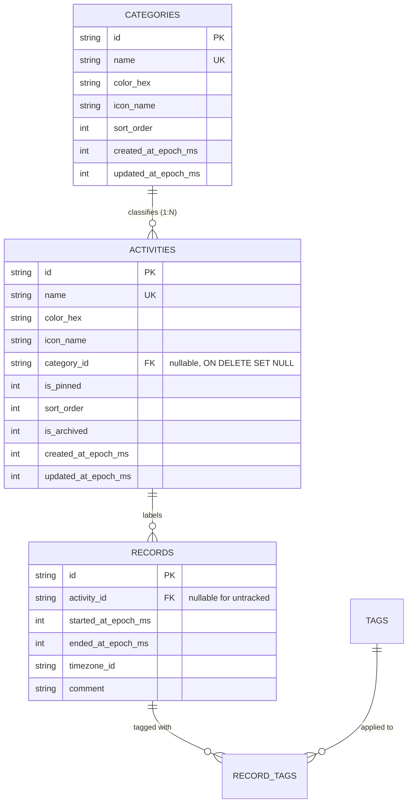
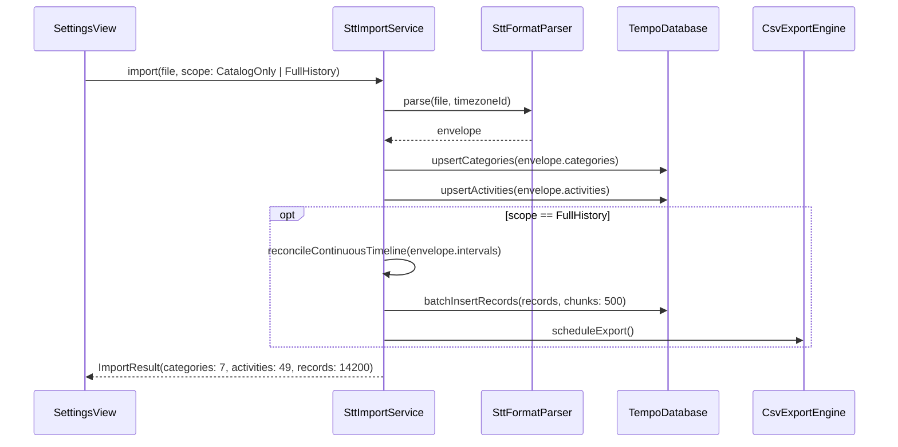

# Simple Time Tracker Import & Category Architecture

* **Author:** Antigravity & User
* **Status:** Approved
* **Date:** 2026-11-03

--------------------------------------------------------------------------------

## Overview

Tempo currently requires manual setup of activities, leaves the `categories` column blank in continuous CSV exports, and has no mechanism to migrate existing data from Simple Time Tracker (STT).

This design introduces a first-class `Category` model, a dual-format parser for STT `.backup` and `.csv` files, continuous-coverage history reconciliation (gap synthesis and local midnight splitting reusing canonical primitives), and a two-stage Settings import dialog.

## The Problem

1. **Missing Category Dimension**: Simple Time Tracker users organize their routines into categories (e.g. `Spiritual`, `Essentials`, `Productivity`, `Transportation`, `Leisure`). In Tempo, no category model exists, and `CsvExportEngine` exports an empty string for the `categories` column, breaking parity with downstream tools like BNPB.
2. **High Onboarding Friction**: Migrating to Tempo requires re-creating dozens of activities manually one by one.
3. **Data Loss During Migration**: Historical time records stored in STT `.csv` files cannot be ingested into Tempo without violating Tempo's strict continuous coverage invariant (untracked gaps and missing time zone offsets).

## Goals

* **Schema Evolution**: Introduce a dedicated `Category` entity and database migration (v5 to v6), linking activities via a nullable `category_id`.
* **Export Parity**: Update `CsvExportEngine` to output the activity's category name in the 5th column (`categories`), restoring 100% STT and BNPB schema parity.
* **Dual-Format Ingestion**: Ingest activity definitions, categories, and colors/icons from either STT `.backup` (tab-delimited) or STT `.csv` (`stt_records_*.csv`) files.
* **Continuous Coverage Invariant**: Reconcile imported historical records into continuous midnight-to-midnight intervals, synthesizing `Untracked Record`s (`activity_id: null`) for unrecorded spans within the active date range.
* **Deterministic Historical Timezone Resolution**: Reconcile wall-clock dates using the historical local offset for the device's active IANA timezone on that specific date, respecting past daylight saving time shifts.
* **Non-Destructive Precedence**: Existing Tempo records take absolute precedence over imported records. If an imported record collides with an existing record, the existing record is preserved.
* **Non-Destructive Merge-Update**: Merge imported activities by case-insensitive name without duplicating records, breaking IDs, or overwriting existing user customizations.
* **Two-Stage Settings UX**: Provide a calm, high-scannability import flow in Settings allowing users to choose between "Catalog Only" (instant setup) and "Full History + Catalog" (with continuous coverage).

## Non-Goals

* Real-time continuous two-way synchronization with the third-party Simple Time Tracker app.
* Ambient background probing of Google Drive sync folders (import is explicitly user-initiated).
* Many-to-many category relationships (strict 1:1 activity-to-category mapping).
* Mutating or pausing the active open Lap or recent records within the 3-second undo window.
* Introducing productivity scoring, streak mechanics, or goal framing on categories.
* Ingesting unrelated roll-call attendance CSVs.

## Open Questions

* None currently open; all design decisions and review findings have been resolved.

## Critical User Journeys (CUJs)

### CUJ 1: Quick Onboarding via Catalog Import (New User)

* **Given**: A user migrating from Simple Time Tracker has an exported `stt_records_automatic.csv` or `.backup` file with 49 activities and 7 categories, and a fresh Tempo installation.
* **When**: The user opens Settings -> "Import from Simple Time Tracker", picks the file via system file picker, and chooses "Catalog Only (Categories & Activities)".
* **Then**: Tempo creates 7 categories and 49 activities with associated colors/icons in SQLite. The Dashboard is immediately populated with categorized activities. The active Lap and Day timeline remain clean and unaffected.

### CUJ 2: Full Historical Migration with Continuous Coverage

* **Given**: An existing STT user has a CSV containing 14 months of time tracking intervals with gaps between logged events.
* **When**: The user selects "Full History + Catalog" in the import dialog.
* **Then**: Tempo imports the catalog, partitions multi-day records at local 00:00 midnight boundaries, synthesizes `Untracked Record`s (`activity_id: null`) for all unrecorded spans between the first and last imported record dates, resolves historical DST offsets, and executes the batch in chunked transactions. `CsvExportEngine` performs a single atomic export upon completion.

--------------------------------------------------------------------------------

## Technical Plan (Architecture)

### 1. Data Model & Relational Schema (Migration v5 -> v6)



* **Schema Migration SQL (`migrateV5ToV6`)**:
  ```sql
  CREATE TABLE IF NOT EXISTS categories (
    id TEXT PRIMARY KEY,
    name TEXT NOT NULL UNIQUE,
    color_hex TEXT NOT NULL,
    icon_name TEXT NOT NULL,
    sort_order INTEGER NOT NULL DEFAULT 0,
    created_at_epoch_ms INTEGER NOT NULL,
    updated_at_epoch_ms INTEGER NOT NULL
  );

  ALTER TABLE activities ADD COLUMN category_id TEXT REFERENCES categories(id) ON DELETE SET NULL;
  CREATE INDEX IF NOT EXISTS idx_activities_category_id ON activities(category_id);
  ```

### 2. Dual-Format Parser Pipeline (`SttFormatParser`)

```text
[Input File (.backup or .csv)]
               │
               ▼
   Format Detection & Validation
      ├─ .backup  ──► Tab-Delimited: recordType, icon mappings, color tokens, categories
      └─ .csv     ──► 8-Column CSV: activity names, categories, wall-clock intervals
               │
               ▼
      Parsed Data Envelope
         ├─ List<Category>
         ├─ List<Activity>
         └─ List<RawInterval>
```

* **Icon & Color Mapping**: Maps STT drawable tokens (e.g. `ic_fitness_center_24px`, `ic_restaurant_menu_24px`) deterministically to Flutter Material Icons (`Icons.fitness_center`, `Icons.restaurant_menu`), falling back to `Icons.schedule`.
* **CSV Category Synthesis**: When importing from `.csv`, category colors are synthesized using a deterministic harmonious palette generator based on the category name.

### 3. Continuous Coverage & Historical Reconciliation (`SttImportService`)

```text
Incoming Raw Intervals (Chronologically Sorted)
                     │
                     ▼
       1. Deterministic Epoch Clamping
       [Earliest Midnight] <─────────────────────> [Latest Midnight / Pre-Lap]
                     │
                     ▼
       2. Historical DST & Timezone Resolution
       [Wall-clock date evaluated via timezone database for exact historical offset]
                     │
                     ▼
       3. Local Midnight Boundary Splitting
       [Interval across 00:00 split into distinct Day records using nextLocalMidnightUtcMs]
                     │
                     ▼
       4. Gap Synthesis (Zero-Gap Millisecond Invariant)
       [Synthesize Untracked Record (activity_id: null) from prev.end to next.start]
                     │
                     ▼
       5. Non-Destructive Precedence
       [Existing Tempo records take absolute precedence; overlapping imports skipped]
                     │
                     ▼
       Continuous Unbroken Timeline
```

* **Canonical Logic Reuse**: Reuses existing gap-filling logic (`_fillRecordGapsWithUntracked`) and midnight boundary resolution (`nextLocalMidnightUtcMs`) to guarantee algorithmic consistency with the rest of Tempo.
* **Lap Protection**: Historical records are strictly clamped to end before `currentLap.startedAtEpochMs`.

### 4. Data Flow & Transaction Batching



--------------------------------------------------------------------------------

## Alternatives Considered

### Alternative A: Ambient Background Google Drive Probing

* **Pros**: Automatically prompts the user if a backup is found in cloud storage.
* **Cons**: Introduces OAuth scope failures (`drive.file` vs `drive.readonly`), background polling, and unsolicited UI interruptions.
* **Reason for Rejection**: Violates YAGNI and user predictability. Explicit user-initiated import via Settings with the system file picker covers local files, Google Drive, and iCloud without background overhead.

### Alternative B: Category as a Plain String Field on Activity

* **Pros**: Eliminates dedicated `categories` table.
* **Cons**: Inconsistent styling across surfaces, lack of centralized category entities, and prone to typographical fragmentation.
* **Reason for Rejection**: A first-class `Category` entity aligns with relational best practices and enables category-level stats aggregation.

### Alternative C: Strict Record Import Without Gap Synthesis

* **Pros**: Stores raw STT intervals with zero synthetic records added.
* **Cons**: Violates Tempo's core invariant: *Continuous Coverage: Every moment of a Day belongs to exactly one Record or the open Lap*.
* **Reason for Rejection**: Preserving Tempo's continuous coverage invariant is non-negotiable. Clamped gap synthesis cleanly bridges external data into Tempo's temporal model.

### Alternative D: Hard Overwrite Conflict Resolution

* **Pros**: Simpler implementation on collision.
* **Cons**: Destroys existing records and user customizations.
* **Reason for Rejection**: Non-destructive merge-update preserves data safety and user edits.

--------------------------------------------------------------------------------

## Detailed Implementation Plan

### 1. Files Changed, Created, or Deleted

| File Path | Action | Rationale |
| :--- | :--- | :--- |
| `lib/data/models/category.dart` | **Create** | Defines immutable `Category` data model with serialization methods (`toMap`, `fromMap`, `copyWith`). |
| `lib/data/models/activity.dart` | **Modify** | Adds nullable `categoryId` property to `Activity`, updating constructor, `toMap`, `fromMap`, and `copyWith`. |
| `lib/data/models/models.dart` | **Modify** | Exports `category.dart`. |
| `lib/data/database/migrations.dart` | **Modify** | Implements `migrateV5ToV6` creating `categories` table and adding `category_id` to `activities`. |
| `lib/data/database/tempo_database.dart` | **Modify** | Bumps `databaseVersion = 6`, registers `migrateV5ToV6`, and adds category DAO methods (`getCategories`, `getCategoryById`, `upsertCategory`, `deleteCategory`). |
| `lib/core/export/csv_export_engine.dart` | **Modify** | Updates record row formatting to look up and output category name in the 5th column (`categories`). |
| `lib/core/import/stt_format_parser.dart` | **Create** | Pure parser for `.backup` tab-delimited text and `.csv` 8-column files into parsed data envelope with icon/color mapping. |
| `lib/core/import/stt_import_service.dart` | **Create** | Service coordinating parsing, continuous coverage reconciliation (gap filling and midnight splitting), transaction batching, and precedence resolution. |
| `lib/ui/stt_import_dialog.dart` | **Create** | Two-stage import dialog: inspection summary card followed by "Catalog Only" vs "Full History" card selectors. |
| `lib/ui/settings_view.dart` | **Modify** | Adds "Import from Simple Time Tracker" action card in Settings. |
| `CONTEXT.md` | **Modify** | Documents `Category` entity, its 1:1 classification of `Activity`, and import invariants. |
| `test/data/category_migration_test.dart` | **Create** | Verifies database upgrade v5 -> v6 and foreign key constraints. |
| `test/core/stt_format_parser_test.dart` | **Create** | Unit tests for both `.backup` and `.csv` parsing edge cases and icon mappings. |
| `test/core/stt_import_service_test.dart` | **Create** | Tests continuous coverage gap synthesis (`activity_id: null`), historical DST offset resolution, and precedence over existing records. |
| `test/core/csv_export_category_test.dart` | **Create** | Confirms exported CSVs populate the 5th column with matching category names. |

### 2. Implementation Boundaries & Guidelines

* **Pure Domain Logic Isolation**: `SttFormatParser` and the reconciliation logic in `SttImportService` are pure Dart classes with zero UI dependencies, allowing exhaustive unit testing.
* **Zero-Gap Continuity**: Synthetic untracked records span strictly from `prev.end` to `next.start` with `activity_id = null`.
* **Historical Timezone Resolution**: Wall-clock dates in CSV imports resolve against the specific historical DST offset for the device's IANA timezone.
* **Atomic Batching**: Record insertion uses chunked SQLite transactions (`db.transaction`, 500 records per chunk) with a single `scheduleExport()` triggered at the end.
